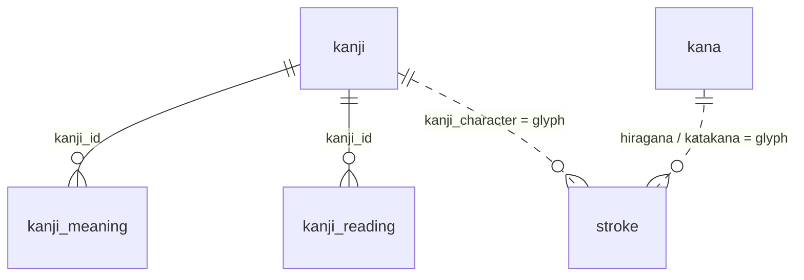

# Database

Kanji Learner stores all of its content in MySQL 8.0: the kanji, their meanings and readings, the kana chart, and the stroke drawings. The frontend gets everything through the backend API; it never talks to the database directly.

## Connection

| Setting  | Value                                                  |
| -------- | ------------------------------------------------------ |
| Engine   | MySQL 8.0 (Docker container `kanji-mysql`)             |
| Database | `kanji` (`MYSQL_DATABASE` in `.env`)                   |
| User     | `MYSQL_USER` / `MYSQL_PASSWORD` in `.env`              |
| Host     | `localhost:3309` from your machine, `mysql:3306` from the backend container |
| Charset  | `utf8mb4`, default collation `utf8mb4_0900_ai_ci`      |

To open a MySQL shell inside the container:

```sh
docker exec -it kanji-mysql sh -c 'mysql -uroot -p"$MYSQL_ROOT_PASSWORD" --default-character-set=utf8mb4 kanji'
```

Always pass `--default-character-set=utf8mb4`. Without it, Japanese text in your queries won't match what is stored.

## Tables



| Table           | Rows  | Holds                                                   |
| --------------- | ----- | ------------------------------------------------------- |
| `kanji`         | 112   | One row per kanji                                       |
| `kanji_meaning` | 158   | Each English meaning of a kanji, with an example sentence |
| `kanji_reading` | 243   | Each reading of a kanji, with an example word and sentence |
| `kana`          | 104   | One cell of the hiragana/katakana chart                 |
| `stroke`        | 1,193 | One stroke of a kanji or kana, for 260 characters       |

The links in the diagram are not foreign keys. `kanji_meaning` and `kanji_reading` store the kanji's `id` in `kanji_id`. `stroke` is matched by character: `stroke.glyph` equals `kanji.kanji_character`, `kana.hiragana` or `kana.katakana`. A combination like きゃ has no strokes of its own; the app looks up き and ゃ separately.

### `kanji`

| Column            | Type           | Notes |
| ----------------- | -------------- | ----- |
| `id`              | bigint, PK     | Auto increment. Has gaps (see [Seeding](#seeding)), so don't rely on ids being consecutive |
| `kanji_character` | varchar(4)     | Unique. The kanji itself, e.g. 日 |
| `onyomi`          | varchar(255)   | Katakana readings, comma separated, e.g. `ニチ, ジツ` |
| `kunyomi`         | varchar(255)   | Hiragana readings, comma separated, e.g. `ひ, か`. Can be empty (校) |
| `english_meaning` | varchar(255)   | Short meaning shown on the card, e.g. `day, sun` |
| `jlpt_level`      | varchar(2)     | `N5` for every kanji so far |
| `stroke_count`    | int            | Must match the number of rows in `stroke` for this kanji |
| `display_order`   | int            | Position in the list, starting at 1. The list, pagination and previous/next all sort by this column |
| `main_reading`    | varchar(255), nullable | Reading shown on the card when it shouldn't be the first hiragana reading, e.g. いち for 一, かい for 会 |

### `kanji_meaning`

| Column                 | Type         | Notes |
| ---------------------- | ------------ | ----- |
| `id`                   | bigint, PK   | |
| `kanji_id`             | bigint       | The `kanji.id` this meaning belongs to |
| `sort_order`           | int          | 1, 2, 3… Unique together with `kanji_id` |
| `meaning`              | varchar(255) | One meaning, e.g. `day` |
| `sentence`             | varchar(255) | Example sentence that uses the kanji, e.g. 日曜日に友達と会います。 |
| `sentence_reading`     | varchar(255) | The sentence in hiragana |
| `sentence_translation` | varchar(255) | The sentence in English |

### `kanji_reading`

| Column                 | Type         | Notes |
| ---------------------- | ------------ | ----- |
| `id`                   | bigint, PK   | |
| `kanji_id`             | bigint       | The `kanji.id` this reading belongs to |
| `sort_order`           | int          | 1, 2, 3… Unique together with `kanji_id` |
| `reading`              | varchar(255) | The reading in hiragana, e.g. `にち` |
| `word`                 | varchar(255) | A common word with this reading, e.g. 毎日 |
| `word_reading`         | varchar(255) | The word in hiragana, e.g. まいにち |
| `word_meaning`         | varchar(255) | The word in English |
| `sentence`             | varchar(255) | Example sentence that uses the word |
| `sentence_reading`     | varchar(255) | The sentence in hiragana |
| `sentence_translation` | varchar(255) | The sentence in English |

The rows must be in the same order as the reading pills on the detail page: `main_reading` first, then the `kunyomi` readings, then the `onyomi` readings converted to hiragana, with duplicates removed. For 日 that is ひ, か, にち, じつ.

### `kana`

| Column         | Type        | Notes |
| -------------- | ----------- | ----- |
| `id`           | bigint, PK  | |
| `section`      | varchar(20) | `basic`, `dakuten` or `combinations` |
| `row_index`    | int         | Row in that section's chart, from 0 |
| `column_index` | int         | Column in that row, from 0. Gaps in the chart (like between や and ゆ) have no row |
| `hiragana`     | varchar(2), binary collation | Unique, e.g. か or きゃ |
| `katakana`     | varchar(2), binary collation | Unique, e.g. カ or キャ |
| `romaji`       | varchar(4)  | Hepburn romaji, e.g. `ka`, `shi`, `kya` |

`(section, row_index, column_index)` is unique. The section titles, notes and column counts are page text kept in `frontend/src/data/kana.js`.

### `stroke`

| Column         | Type         | Notes |
| -------------- | ------------ | ----- |
| `id`           | bigint, PK   | |
| `glyph`        | varchar(2), binary collation | The kanji or kana, e.g. 日 or か |
| `stroke_order` | int          | 1 for the first stroke, 2 for the second… Unique together with `glyph` |
| `path`         | varchar(512) | SVG path `d` of the stroke on a 109×109 grid |

The paths come from [KanjiVG](https://kanjivg.tagaini.net/) (CC BY-SA 3.0).

### Why some columns use a binary collation

The default collation, `utf8mb4_0900_ai_ci`, ignores accents and kana type, so it treats か, カ and が as the same character. That would break the unique keys and the lookups on `kana` and `stroke`. `kana.hiragana`, `kana.katakana` and `stroke.glyph` therefore use `utf8mb4_bin`, which compares characters exactly. The collation is set with `columnDefinition` on the entities in `backend/.../kana/Kana.java` and `backend/.../stroke/Stroke.java`.

## How the schema is created

There are no migration files. Hibernate creates and updates the tables from the JPA entities when the backend starts (`spring.jpa.hibernate.ddl-auto=update`):

| Table           | Entity |
| --------------- | ------ |
| `kanji`         | `com.kanji.backend.kanji.Kanji` |
| `kanji_meaning` | `com.kanji.backend.kanji.KanjiMeaning` |
| `kanji_reading` | `com.kanji.backend.kanji.KanjiReading` |
| `kana`          | `com.kanji.backend.kana.Kana` |
| `stroke`        | `com.kanji.backend.stroke.Stroke` |

`update` adds new tables and columns, but never drops or renames anything. If you rename a field, the old column stays in the database until you remove it yourself.

## Seeding

After Hibernate has built the tables, Spring runs three SQL files from `backend/src/main/resources/` on every start:

| File          | Fills |
| ------------- | ----- |
| `data.sql`    | `kanji`, `kanji_meaning`, `kanji_reading` |
| `kana.sql`    | `kana` |
| `strokes.sql` | `stroke` |

Every statement is an upsert (`INSERT … AS new ON DUPLICATE KEY UPDATE …`), so running them again only updates existing rows and never creates duplicates. `kanji_meaning` and `kanji_reading` are inserted with `INSERT … SELECT … JOIN kanji` so they can look up each kanji's `id` by its character.

Two side effects:

- **Deleting from a seed file doesn't delete from the database.** Removing a kanji from `data.sql` leaves its rows in place. Delete them in MySQL too (see below).
- **Ids have gaps.** Each upsert uses up auto-increment values even when it only updates a row. The app never depends on ids being consecutive; ordering always uses `display_order`.

## Common tasks

### Add a kanji

1. In `data.sql`, add a row to the `kanji` insert with the next `display_order`.
2. Add its meaning rows and reading rows. The reading rows follow the pill order described under [`kanji_reading`](#kanji_reading).
3. Add its stroke paths to `strokes.sql`, from the KanjiVG SVG for that character. The number of strokes must equal `stroke_count`.
4. Rebuild the backend: `docker compose up --build -d backend`.

### Delete a kanji

The tables have no foreign keys, so delete the child rows as well:

```sql
SET @id = (SELECT id FROM kanji WHERE kanji_character = '犬');
DELETE FROM kanji_meaning WHERE kanji_id = @id;
DELETE FROM kanji_reading WHERE kanji_id = @id;
DELETE FROM stroke WHERE glyph = '犬';
DELETE FROM kanji WHERE id = @id;
```

Then remove it from `data.sql` and `strokes.sql` too, or it comes back on the next start.

### Check the data

```sql
-- Kanji whose stroke_count doesn't match their stroke rows
SELECT k.kanji_character, k.stroke_count, COUNT(s.id) AS strokes
FROM kanji k LEFT JOIN stroke s ON s.glyph = k.kanji_character
GROUP BY k.id HAVING k.stroke_count <> strokes;

-- Kanji without meanings or readings
SELECT kanji_character FROM kanji k
WHERE NOT EXISTS (SELECT 1 FROM kanji_meaning m WHERE m.kanji_id = k.id)
   OR NOT EXISTS (SELECT 1 FROM kanji_reading r WHERE r.kanji_id = k.id);
```

Both queries return no rows for the current data.

### Start from an empty database

This deletes all data. The seed files then rebuild it on the next start:

```sh
docker compose down -v
docker compose up --build
```
